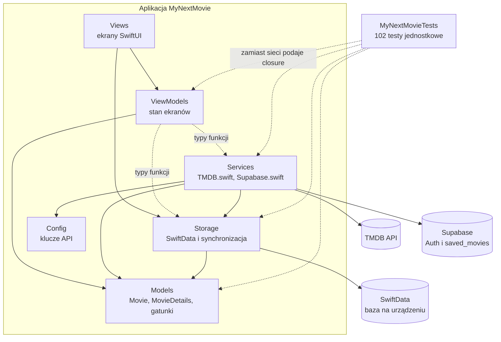
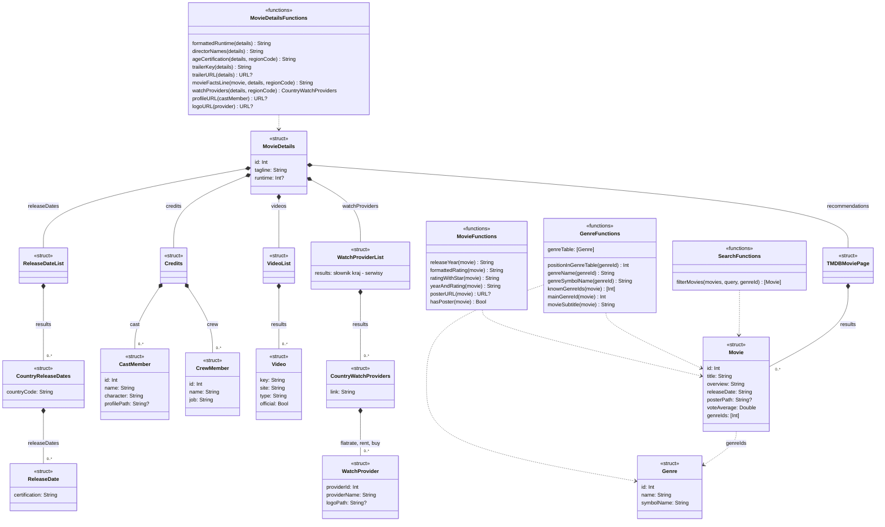
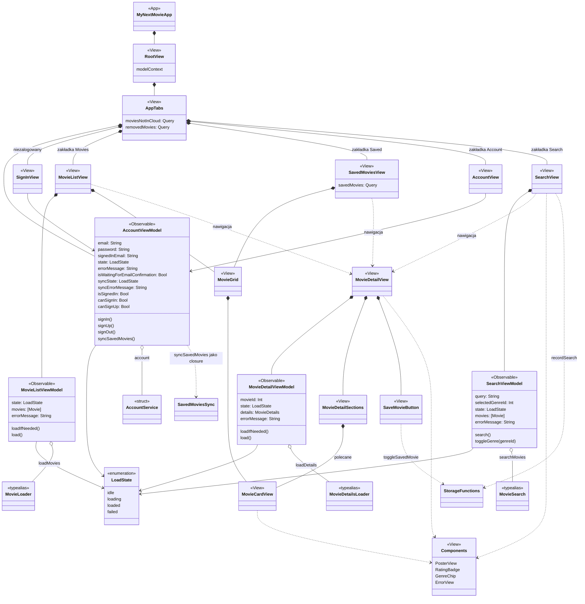
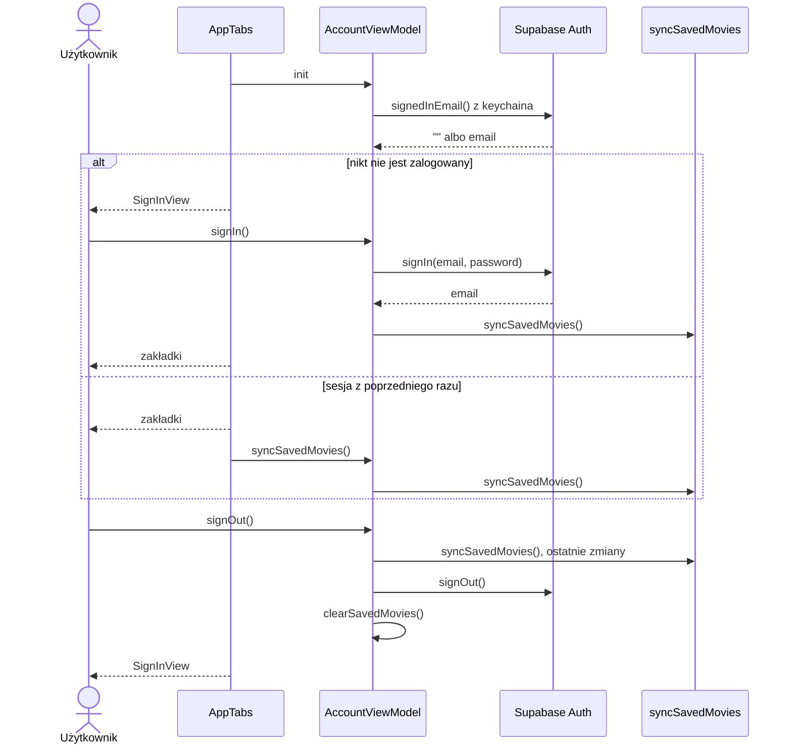
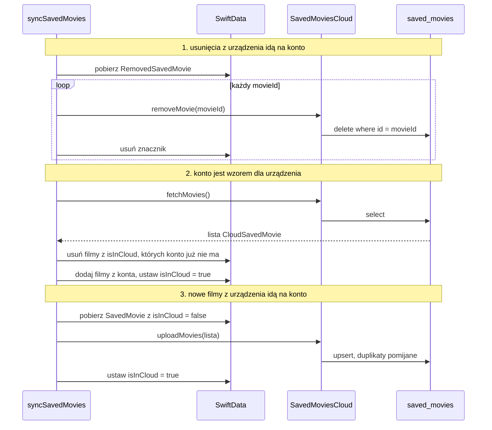
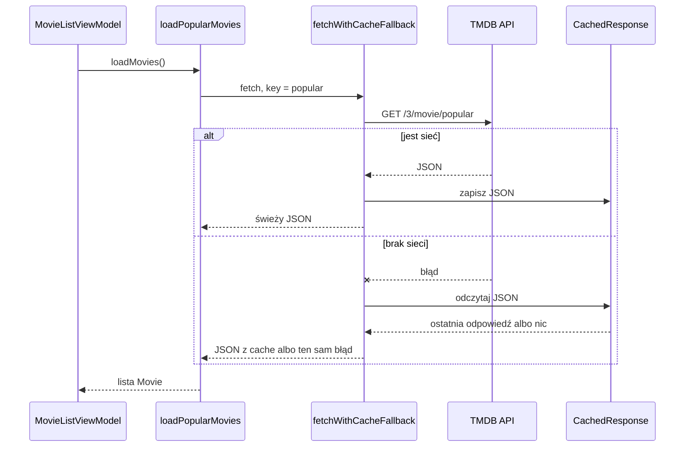

# Architektura (UML)

Diagramy są w Mermaid. GitHub rysuje je sam, w Xcode widać sam tekst. Opisują całą aplikację, czyli stan po lab 5.

Projekt jest napisany proceduralnie. Większość kodu to struktury bez metod i zwykłe funkcje. Na diagramach klas:

- `<<struct>>` to struktura z danymi,
- `<<functions>>` to plik ze zwykłymi funkcjami, a nie klasa,
- `<<typealias>>` to typ funkcji przekazywanej jako zależność,
- `<<Observable>>` i `<<Model>>` to jedyne prawdziwe klasy w aplikacji.

Bazy danych opisuje `docs/database.md`.

## Warstwy



View model nie zna TMDB ani Supabase. Dostaje funkcje w `init`. Aplikacja podaje prawdziwe zapytania, testy podają closure.

## Modele



## Serwisy i przechowywanie

```mermaid
classDiagram
    class MovieLoader {
        <<typealias>>
        () async throws [Movie]
    }
    class MovieSearch {
        <<typealias>>
        (query, genreId) async throws [Movie]
    }
    class MovieDetailsLoader {
        <<typealias>>
        (movieId) async throws MovieDetails
    }
    class AccountRequest {
        <<typealias>>
        (email, password) async throws String
    }
    class AccountService {
        <<struct>>
        signedInEmail: () String
        signIn: AccountRequest
        signUp: AccountRequest
        signOut: () async throws
    }
    class SavedMoviesCloud {
        <<struct>>
        fetchMovies: () async throws [CloudSavedMovie]
        uploadMovies: ([CloudSavedMovie]) async throws
        removeMovie: (movieId) async throws
    }
    class CloudSavedMovie {
        <<struct>>
        id: Int
        title: String
        overview: String
        releaseDate: String
        posterPath: String?
        voteAverage: Double
        genreIds: [Int]
        savedAt: Date
    }
    class TMDB {
        <<functions>>
        loadPopularMovies(cache) [Movie]
        fetchPopularMovies() [Movie]
        searchTMDBMovies(query, genreId) [Movie]
        loadTMDBMovieDetails(movieId, cache) MovieDetails
        fetchMovieDetails(movieId) MovieDetails
        tmdbURL(path, parameters, apiKey) URL?
        decodeTMDBMovies(data) [Movie]
        decodeTMDBMovieDetails(data) MovieDetails
        checkTMDBResponse(response)
    }
    class Supabase {
        <<functions>>
        supabaseAccountService: AccountService
        supabaseSavedMoviesCloud: SavedMoviesCloud
        supabaseSignedInEmail() String
        signInToSupabase(email, password) String
        signUpToSupabase(email, password) String
        signOutOfSupabase()
        fetchCloudSavedMovies() [CloudSavedMovie]
        uploadCloudSavedMovies(cloudMovies)
        removeCloudSavedMovie(movieId)
    }
    class AppConfig {
        <<functions>>
        tmdbAPIKey() String
        supabaseURL() String
        supabaseAnonKey() String
    }
    class TMDBError {
        <<struct>>
        message: String
    }
    class SupabaseError {
        <<struct>>
        message: String
    }
    class StorageFunctions {
        <<functions>>
        isMovieSaved(context, movieId) Bool
        toggleSavedMovie(context, movie, now)
        clearSavedMovies(context)
        moviesFromSaved(savedMovies) [Movie]
        recordSearch(context, query, now)
        recentSearches(context) [SearchHistoryEntry]
        clearSearchHistory(context)
        cachedResponseData(context, key) Data
        storeCachedResponse(context, key, data, now)
        fetchWithCacheFallback(context, key, fetch) Data
    }
    class SavedMoviesSync {
        <<functions>>
        syncSavedMovies(context, cloud)
        cloudMovieFromSaved(savedMovie) CloudSavedMovie
        movieFromCloud(cloudMovie) Movie
    }
    class SavedMovie {
        <<Model>>
        movieId: Int
        title: String
        savedAt: Date
        isInCloud: Bool
    }
    class RemovedSavedMovie {
        <<Model>>
        movieId: Int
    }
    class SearchHistoryEntry {
        <<Model>>
        query: String
        searchedAt: Date
    }
    class CachedResponse {
        <<Model>>
        key: String
        data: Data
        fetchedAt: Date
    }

    TMDB ..|> MovieLoader : loadPopularMovies
    TMDB ..|> MovieSearch : searchTMDBMovies
    TMDB ..|> MovieDetailsLoader : loadTMDBMovieDetails
    TMDB ..> AppConfig
    TMDB ..> TMDBError : throws
    TMDB ..> StorageFunctions : fetchWithCacheFallback
    Supabase ..> AppConfig
    Supabase ..> SupabaseError : throws
    Supabase ..> AccountService : wypełnia
    Supabase ..> SavedMoviesCloud : wypełnia
    AccountService o-- AccountRequest
    SavedMoviesCloud ..> CloudSavedMovie
    SavedMoviesSync ..> SavedMoviesCloud : używa
    SavedMoviesSync ..> SavedMovie
    SavedMoviesSync ..> RemovedSavedMovie
    StorageFunctions ..> SavedMovie
    StorageFunctions ..> RemovedSavedMovie
    StorageFunctions ..> SearchHistoryEntry
    StorageFunctions ..> CachedResponse
```

## View modele i ekrany



`RootView` ma kontekst SwiftData. Opakowuje nim funkcje, które go potrzebują: cache TMDB i synchronizację. Dzięki temu view modele dostają zwykłe typy funkcji.

## Start aplikacji i logowanie



## Synchronizacja listy zapisanych filmów

Lista działa bez sieci. Zmiany czekają na urządzeniu, aż synchronizacja je wyśle. `AppTabs` uruchamia ją przy starcie, po powrocie do aplikacji i gdy pojawi się niewysłana zmiana.



Gdy zapytanie się nie uda, funkcja rzuca błąd. Znaczniki zostają i następna synchronizacja wyśle resztę.

## Pobranie filmów z cache



## Testy jednostkowe

Testy są w `MyNextMovieTests/` i używają Swift Testing. Jest ich 102 w 15 zestawach. Żaden nie łączy się z siecią. Plan `MyNextMovie.xctestplan` uruchamia je w losowej kolejności i zbiera pokrycie kodu.

```mermaid
classDiagram
    class MovieTests {
        <<suite>>
        10 testów
    }
    class GenreTests {
        <<suite>>
        6 testów
    }
    class FilterMoviesTests {
        <<suite>>
        7 testów
    }
    class MovieDetailsDecodingTests {
        <<suite>>
        6 testów
    }
    class MovieDetailsTests {
        <<suite>>
        14 testów
    }
    class TMDBTests {
        <<suite>>
        11 testów
    }
    class SavedMovieTests {
        <<suite>>
        5 testów
    }
    class SearchHistoryTests {
        <<suite>>
        5 testów
    }
    class ResponseCacheTests {
        <<suite>>
        5 testów
    }
    class SavedMoviesSyncTests {
        <<suite>>
        8 testów
    }
    class CloudSavedMovieTests {
        <<suite>>
        2 testy
    }
    class MovieListViewModelTests {
        <<suite>>
        4 testy
    }
    class MovieDetailViewModelTests {
        <<suite>>
        4 testy
    }
    class SearchViewModelTests {
        <<suite>>
        4 testy
    }
    class AccountViewModelTests {
        <<suite>>
        11 testów
    }
    class TestMovies {
        <<data>>
        testMovies: [Movie]
        testMovieDetails: MovieDetails
        makeMovie()
    }
    class NoConnection {
        <<error>>
    }
    class TestCloud {
        <<fake>>
        movies: [CloudSavedMovie]
        isOffline: Bool
    }
    class TestAccount {
        <<fake>>
        signedInEmail: String
        isOffline: Bool
        needsEmailConfirmation: Bool
        syncCount: Int
        clearCount: Int
    }
    class makeTestContainer {
        <<helper>>
        baza SwiftData w pamięci
    }

    MovieTests ..> MovieFunctions : testuje
    GenreTests ..> GenreFunctions : testuje
    FilterMoviesTests ..> SearchFunctions : testuje
    MovieDetailsDecodingTests ..> MovieDetails : dekodowanie JSON
    MovieDetailsTests ..> MovieDetailsFunctions : testuje
    TMDBTests ..> TMDB : adresy, dekodowanie, statusy HTTP
    SavedMovieTests ..> StorageFunctions : lista zapisanych
    SearchHistoryTests ..> StorageFunctions : historia
    ResponseCacheTests ..> StorageFunctions : cache
    SavedMoviesSyncTests ..> SavedMoviesSync : testuje
    CloudSavedMovieTests ..> CloudSavedMovie : nazwy kolumn
    MovieListViewModelTests ..> MovieListViewModel : testuje
    MovieDetailViewModelTests ..> MovieDetailViewModel : testuje
    SearchViewModelTests ..> SearchViewModel : testuje
    AccountViewModelTests ..> AccountViewModel : testuje

    SavedMoviesSyncTests ..> TestCloud : zamiast Supabase
    AccountViewModelTests ..> TestAccount : zamiast Supabase
    SavedMovieTests ..> makeTestContainer
    SearchHistoryTests ..> makeTestContainer
    ResponseCacheTests ..> makeTestContainer
    SavedMoviesSyncTests ..> makeTestContainer
    MovieListViewModelTests ..> NoConnection
    AccountViewModelTests ..> NoConnection
    ResponseCacheTests ..> NoConnection
    SavedMoviesSyncTests ..> NoConnection
    MovieListViewModelTests ..> TestMovies
    FilterMoviesTests ..> TestMovies
    SavedMoviesSyncTests ..> TestMovies
```



| Zestaw | Plik | Testów | Co sprawdza |
| --- | --- | --- | --- |
| `MovieTests` | `MovieTests.swift` | 10 | rok, ocena, adres plakatu, podtytuł |
| `GenreTests` | `MovieTests.swift` | 6 | tabela gatunków, nieznane id |
| `FilterMoviesTests` | `SearchTests.swift` | 7 | filtrowanie po tekście i gatunku |
| `SearchViewModelTests` | `SearchTests.swift` | 4 | stan ekranu Search |
| `MovieDetailsDecodingTests` | `MovieDetailsTests.swift` | 6 | dekodowanie szczegółów z JSON |
| `MovieDetailsTests` | `MovieDetailsTests.swift` | 14 | czas trwania, reżyserzy, zwiastun, kategoria wiekowa |
| `TMDBTests` | `TMDBTests.swift` | 11 | adresy zapytań, dekodowanie, błędy HTTP |
| `SavedMovieTests` | `StorageTests.swift` | 5 | zapis, usunięcie, znaczniki, czyszczenie |
| `SearchHistoryTests` | `StorageTests.swift` | 5 | kolejność, limit, czyszczenie historii |
| `ResponseCacheTests` | `StorageTests.swift` | 5 | cache i praca bez sieci |
| `SavedMoviesSyncTests` | `SavedMoviesSyncTests.swift` | 8 | synchronizacja w obie strony, zmiany offline |
| `CloudSavedMovieTests` | `SavedMoviesSyncTests.swift` | 2 | nazwy kolumn, kopia pól filmu |
| `MovieListViewModelTests` | `MovieListViewModelTests.swift` | 4 | stan listy filmów |
| `MovieDetailViewModelTests` | `MovieDetailViewModelTests.swift` | 4 | stan ekranu szczegółów |
| `AccountViewModelTests` | `AccountViewModelTests.swift` | 11 | logowanie, rejestracja, wylogowanie, synchronizacja |

Czego testy nie obejmują:

- widoków SwiftUI,
- prawdziwych zapytań do TMDB i Supabase (`Supabase.swift` jest tylko cienką warstwą nad SDK),
- zasad Row Level Security w bazie.
