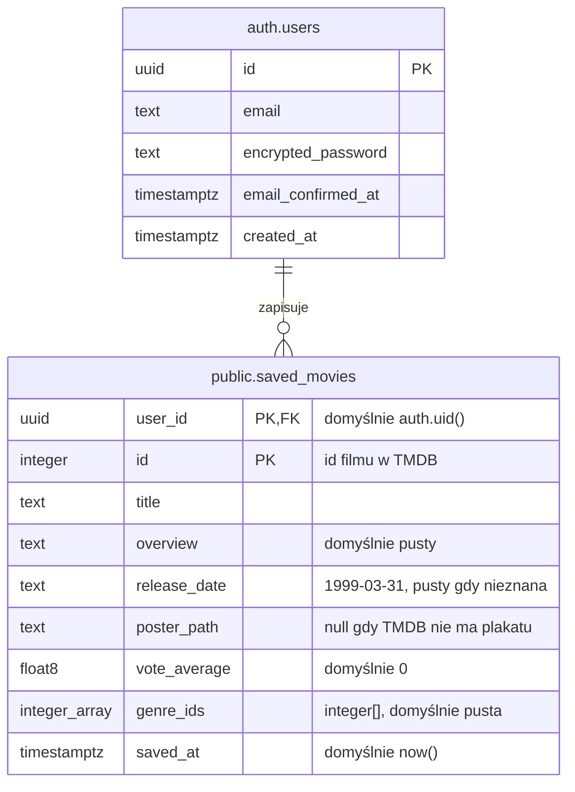
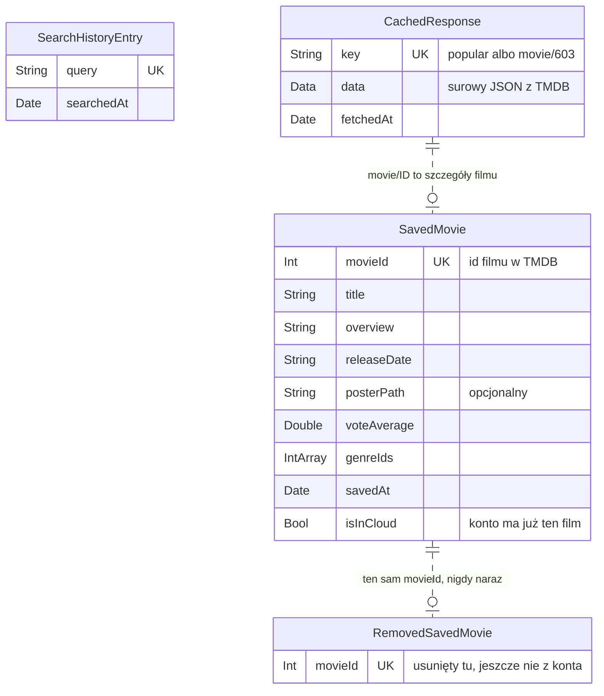
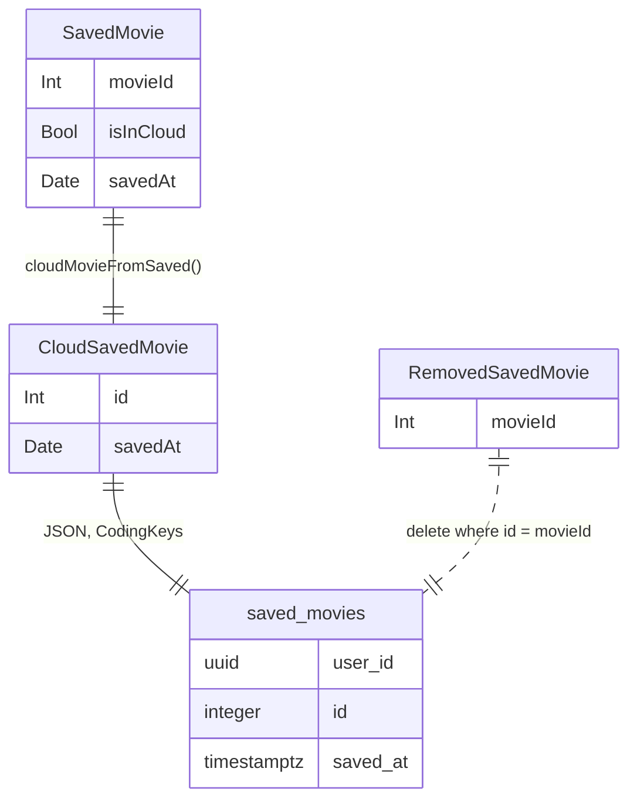

# Bazy danych

Aplikacja ma dwie bazy:

- **Supabase** (PostgreSQL w chmurze): konta i zapisane filmy użytkownika.
- **SwiftData** (na urządzeniu): zapisane filmy, historia wyszukiwania i cache odpowiedzi TMDB.

Diagramy są w Mermaid. GitHub rysuje je sam, w Xcode widać sam tekst. Opisują całą aplikację, czyli stan po lab 5.

## Supabase

Schemat tworzy migracja `supabase/migrations/20261007214802_create_saved_movies.sql`.
Tabela `auth.users` należy do Supabase Auth. Aplikacja jej nie zmienia.

Zasady:

- Klucz główny to para `(user_id, id)`. Jeden użytkownik ma dany film najwyżej raz.
- `user_id` wskazuje `auth.users(id)` z `on delete cascade`. Usunięcie konta usuwa jego filmy.
- Kolumny mają te same nazwy co JSON z TMDB (snake_case). Wiersz to pola struktury `Movie` plus `saved_at`.
- Film nie ma własnej tabeli. Dane filmu są kopią z TMDB, żeby lista działała bez pytania TMDB.

Row Level Security jest włączone. Każdy widzi i zmienia tylko swoje wiersze:

| Operacja | Rola | Warunek |
| --- | --- | --- |
| `select` | `authenticated` | `auth.uid() = user_id` |
| `insert` | `authenticated` | `auth.uid() = user_id` |
| `delete` | `authenticated` | `auth.uid() = user_id` |

Nie ma zasady dla `update`. Aplikacja tylko dodaje i usuwa wiersze.

Konto testowe `test@test.test` z hasłem `test` tworzy `supabase/seed.sql`.

## SwiftData

Modele są w `MyNextMovie/Storage/StoredModels.swift`. Między modelami nie ma relacji SwiftData. Łączy je tylko `movieId`, czyli id filmu w TMDB.

Co trzyma każdy model:

| Model | Po co | Limit |
| --- | --- | --- |
| `SavedMovie` | lista do obejrzenia, działa bez sieci | brak |
| `RemovedSavedMovie` | znacznik: usuń ten film także z konta | znika po synchronizacji |
| `SearchHistoryEntry` | ostatnie wyszukiwania na ekranie Search | 10 najnowszych |
| `CachedResponse` | ostatnia odpowiedź TMDB, pokazywana bez sieci | jedna na klucz |

## Jak obie bazy się łączą

Wiersz `saved_movies` i obiekt `SavedMovie` opisują ten sam film. Pośredniczy struktura `CloudSavedMovie`.

| SwiftData `SavedMovie` | `CloudSavedMovie` | kolumna `saved_movies` |
| --- | --- | --- |
| `movieId` | `id` | `id` |
| `title` | `title` | `title` |
| `overview` | `overview` | `overview` |
| `releaseDate` | `releaseDate` | `release_date` |
| `posterPath` | `posterPath` | `poster_path` |
| `voteAverage` | `voteAverage` | `vote_average` |
| `genreIds` | `genreIds` | `genre_ids` |
| `savedAt` | `savedAt` | `saved_at` |
| `isInCloud` | brak | brak, wynika z istnienia wiersza |
| brak | brak | `user_id`, wpisuje baza |

Synchronizację opisuje `docs/architecture.md`.
